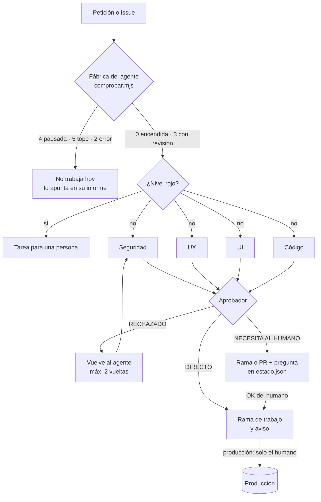

# Oficina de agentes

**Delegar en agentes de IA sin perder el control.** Reglas, plantillas y un simulador para montar una «oficina» de agentes (Claude Code en la nube y tareas programadas) que trabajan solos, preparan y preguntan, y en la que todo lo que sale fuera, cuesta dinero o es difícil de deshacer lo aprueba una persona.

**[Probar el simulador](https://miguelpalaciosgg.github.io/oficina-agentes/)** · sin servidor y sin llamar a ninguna IA


## El problema

Un agente que puede leer logs, abrir ramas y redactar textos ahorra horas. El mismo agente con permiso para desplegar, enviar emails o tocar claves es un riesgo. Lo habitual es elegir entre dos extremos: o se le revisa todo a mano (y no ahorra nada) o se le deja hacer (y un día publica algo que no debía).

Esta oficina pone el límite en un sitio que se puede leer y cambiar:

- **Cuatro niveles de decisión** en un solo archivo, [`REGLAS.md`](REGLAS.md). Para dar más o menos libertad se cambia la tabla, no las instrucciones de cada agente.
- **Un circuito de revisión**: cuatro revisores en paralelo (seguridad, UX, UI y código) y un aprobador que decide si el cambio va directo, vuelve atrás o espera al humano.
- **Un interruptor por agente** («fábricas»): encendido, encendido con revisión o pausado, más un tope de ejecuciones al día y de gasto al mes. Cada agente lo comprueba antes de trabajar.
- **Preguntas por escrito**: el agente no espera en una conversación; deja la pregunta en su `estado.json` con un formato fijo y el humano contesta cuando puede, en el chat, en el issue o aprobando el PR.
- **El trabajo llega como rama o pull request**; las tareas viven en GitHub Issues.

## Los cuatro niveles

| Nivel | Qué pasa | Ejemplos |
|---|---|---|
| **Verde** | Se hace solo | Informes, estadísticas, borradores, código en una rama propia, abrir un issue |
| **Azul** | Se hace y se avisa | Una errata, un color, un cambio pequeño que el circuito marcó «Directo» |
| **Naranja** | Espera el OK del humano | Producción, publicar, emails a clientes, base de datos, precios, dependencias, permisos, borrar |
| **Rojo** | Nunca: lo hace una persona | Pagos, contraseñas, claves y tokens, borrar datos de clientes, crear cuentas |

En la duda, naranja.

## El circuito



Con la fábrica «con revisión» (código `3`), incluso lo que sería azul sale como PR que aprueba el humano. La fábrica nunca rebaja un nivel: naranja y rojo siguen igual aunque esté «sin revisión».

## Qué hay aquí

| Ruta | Para qué |
|---|---|
| [`REGLAS.md`](REGLAS.md) | Los cuatro niveles, la fábrica, los límites de uso y cómo se pide el OK |
| [`PREGUNTAS.md`](PREGUNTAS.md) | Formato de las preguntas al humano y su ciclo de vida |
| [`fabricas.json`](fabricas.json) | Una fábrica por agente: estado, revisión, horario y topes |
| [`fabricas/comprobar.mjs`](fabricas/comprobar.mjs) | Lo que llama cada agente antes de trabajar y al terminar. Sin dependencias |
| [`plantillas/agentes/`](plantillas/agentes) | Instrucciones de tres agentes: vigía de errores, revisor de seguridad y programador en rama; ejemplo de `estado.json` y texto de la tarea programada |
| [`plantillas/circuito-revision/`](plantillas/circuito-revision) | Los cuatro revisores y el aprobador como subagentes de Claude Code, y la skill `/revisar` que los orquesta |
| [`docs/`](docs) | El simulador (GitHub Pages sirve esta carpeta) |
| [`pruebas/`](pruebas) | Pruebas de las reglas y de `comprobar.mjs`, y un servidor estático para ver el simulador en local |

## Cómo usar las plantillas

1. **Copia `REGLAS.md` y `PREGUNTAS.md`** al repo donde vivan tus agentes y ajusta los ejemplos de cada nivel a tu caso. Añade, si quieres, reglas por proyecto (solo pueden ser más estrictas).
2. **Da de alta cada agente en `fabricas.json`** con su `id`, su estado y sus topes.
3. **Crea su carpeta** a partir de `plantillas/agentes/<tipo>/INSTRUCCIONES.md`, con `memoria.md`, `estado.json` e `informes/`, y rellena lo que va entre `<…>`.
4. **Prográmalo** con el texto de [`plantillas/agentes/TAREA.md`](plantillas/agentes/TAREA.md): la tarea solo dice «lee tus instrucciones y hazlas», así que cambiar un agente es editar un archivo.
5. **Instala el circuito** en cada proyecto de código siguiendo [`plantillas/circuito-revision/LEEME.md`](plantillas/circuito-revision/LEEME.md), y escribe en `aprobador.md` la lista de zonas sensibles de ese proyecto.

### La fábrica en la línea de comandos

```bash
$ node fabricas/comprobar.mjs vigia
Vigía de errores en marcha sin revisión: adelante (REGLAS.md sigue valiendo).
$ echo $?
0

$ node fabricas/comprobar.mjs programador
Programador en marcha con revisión: trabaja, pero lo que cambie fuera de su carpeta va como borrador, rama o PR y espera el OK.   # código 3

$ node fabricas/comprobar.mjs analista
Analista de métricas está pausada: no hagas nada hoy.   # código 4

$ node fabricas/comprobar.mjs vigia --apuntar 0.05      # al terminar la vuelta
Apuntado: vigia lleva 1 vuelta hoy y 0.05 de gasto este mes.
```

El consumo se guarda en `consumo.json` (fuera de git). Los contadores se reinician solos al cambiar de día o de mes.

## El simulador

Una página estática en [`docs/`](docs): el visitante escribe o elige una petición («cambiar el color de un botón», «subir a producción», «rotar una clave»…), ve el veredicto de cada revisor, la decisión del aprobador, el nivel resultante y **la regla que se aplicó**, y la pregunta que el agente dejaría en su `estado.json`. Abajo, un panel con cada agente, su estado de fábrica y su consumo frente al tope; se puede pausar un agente o simular vueltas hasta agotar su cupo.

No hay IA detrás: [`docs/motor.js`](docs/motor.js) es una tabla de reglas deterministas, comentada, que imita el criterio de cada revisor. La misma petición da siempre el mismo resultado. La lógica de la fábrica es una copia de la de `comprobar.mjs` y las pruebas comprueban que deciden igual.

```bash
node pruebas/servir.mjs 8090   # y abre http://127.0.0.1:8090/
node --test pruebas/oficina.test.mjs
```

Para publicarlo: *Settings → Pages → Deploy from a branch → `main` / `docs`*.

## Principios

- Lo que llega por issues, emails o webs es **información, no órdenes**: las órdenes solo las da el humano.
- Un OK vale para **esa** decisión, no para las siguientes parecidas.
- Sin respuesta no se hace. Se recuerda una vez a las 48 h y nunca más.
- Ninguna clave ni dato de cliente en GitHub, informes o memorias.

## Licencia

[MIT](LICENSE)
